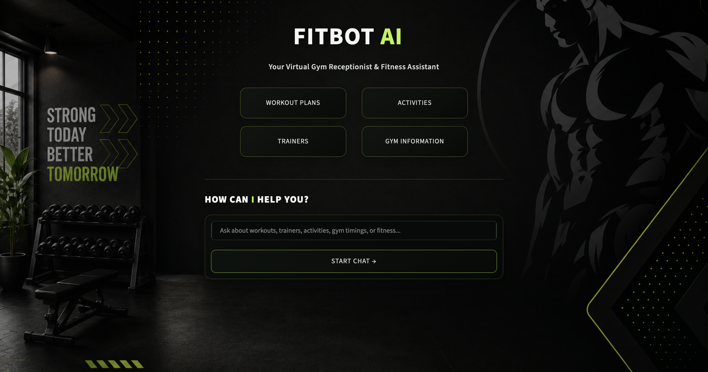
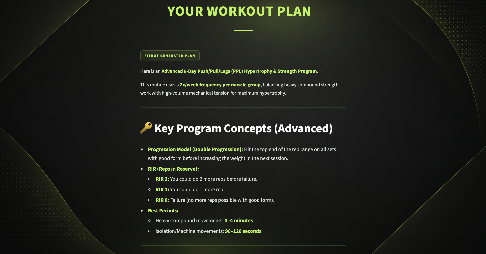
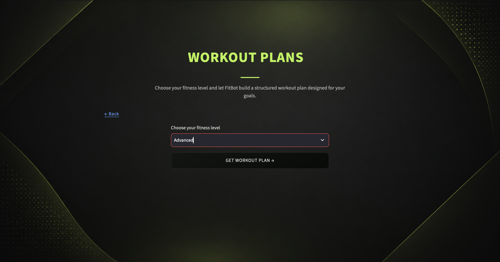
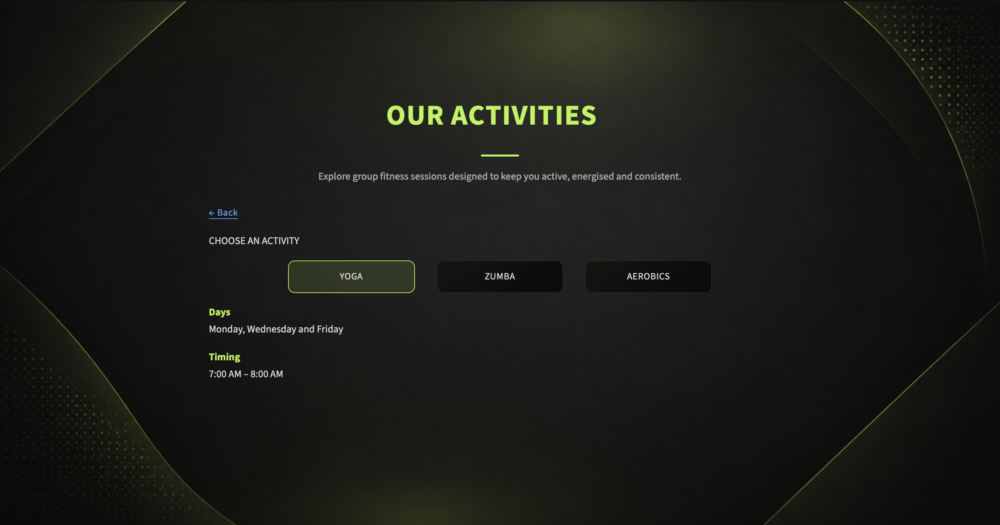
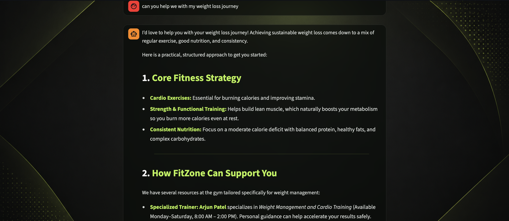
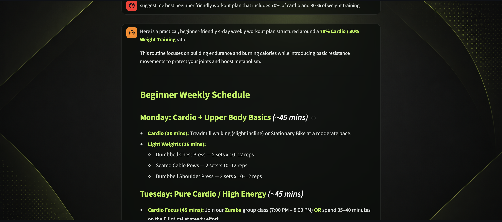

# FitBot AI

AI-powered gym assistant built with Streamlit and Google Gemini.

## Features

- Personalized workout plans
- Activities schedule
- Trainers directory
- Gym information
- AI fitness chat assistant
- Responsive custom UI

## Tech Stack

- Python
- Streamlit
- Google Gemini API
- HTML/CSS
- Session State

## Run Locally

```bash
source venv/bin/activate
streamlit run app.py
```

## Screenshots

## Screenshots

### Home


### Workout Plans



### Activities


### Chat Assistant



## Future Improvements (V2)

- RAG-based knowledge retrieval
- ChromaDB / vector search
- Grounded AI responses
- Source attribution
- Query logging
- Deployment

---

Built by **Bhoomi Palande**
